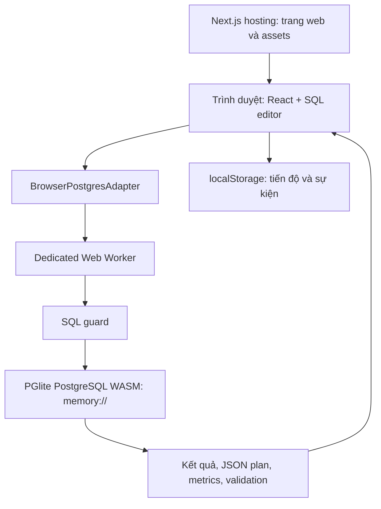

# Kiến trúc và dữ liệu hiện tại

**Cập nhật 08/10/2026:** có hai adapter dùng chung guard/validator: browser PGlite và PostgreSQL native qua connector. Các đoạn RAM/Worker bên dưới mô tả chế độ browser. Native dùng schema `datalab_lab`, dataset persistent có metadata/version, ghép nối và job relay; xem [cài đặt và giới hạn](native-connector-setup.md).

**Trạng thái:** đã triển khai. Đây là kiến trúc của beta hiện có; [lab server](server-labs-design.md) là phương án riêng chưa có trong code.

Prototype [lab PostgreSQL riêng](native-connector-setup.md) đã có connector/API gửi SQL, plan và preview giới hạn. Các khẳng định SQL chạy trong RAM và không gửi ra ngoài dưới đây chỉ áp dụng chế độ browser. Native giữ mật khẩu DB tại connector nhưng SQL/plan/preview đi qua relay.

## SQL chạy ở đâu?



Server hosting cung cấp trang và file JS/WASM. Dataset, truy vấn, index và chấm bài chạy trên CPU/RAM của thiết bị người học. **Chế độ native đã có prototype API relay**: web gửi job, connector trên máy người học nhận job và thực thi PostgreSQL. API không giữ mật khẩu DB và không trực tiếp mở connection SQL. Xem [hướng dẫn native](native-connector-setup.md).

Web Worker giúp việc thực thi WASM tách khỏi luồng giao diện. Worker xử lý yêu cầu tuần tự trên một PGlite connection, trả kết quả qua message có request ID. Nó không phải máy chủ riêng và không áp đặt quota CPU/RAM ở cấp hệ điều hành.

## Dữ liệu cố định hay ngẫu nhiên?

Fixture là dữ liệu thương mại điện tử tổng hợp, sinh bằng công thức xác định trong [seed.ts](../lib/engine/seed.ts). Cùng kích thước luôn tạo cùng dữ liệu ban đầu; không lấy dữ liệu thật của người dùng và không random lại mỗi lần mở.

Database được tạo tại runtime để người học có session riêng. Các bài có thể chạy thêm `setupSql` để tạo trạng thái ban đầu khác nhau. Người học sửa index trong session của mình, không ảnh hưởng người khác.

| Bảng | Cột chính | Số dòng |
| --- | --- | --- |
| `customers` | `id`, `name`, `email`, `city` | 1.000 |
| `products` | `id`, `name`, `category`, `price` | 100 |
| `orders` | `id`, `customer_id`, `order_date`, `status`, `total` | N |
| `order_items` | `id`, `order_id`, `product_id`, `quantity`, `unit_price` | 2 × N |

Tất cả bảng có primary key `id`. Foreign key: `orders.customer_id → customers.id`, `order_items.order_id → orders.id`, `order_items.product_id → products.id`. Các cột fixture khai báo NOT NULL; price không âm và quantity dương. Tiền dùng `numeric(12,2)`, ngày dùng `date`.

Ngày đơn hàng sinh từ mốc `2024-01-01` và công thức cố định; status gồm completed/pending/cancelled. Mỗi order có hai item, `orders.total` tính từ item. Sau khi seed, hệ thống chạy ANALYZE để planner có statistics.

| Lựa chọn N orders | order_items | Tổng dòng cả 4 bảng | Có ở đâu? |
| --- | --- | --- | --- |
| 10.000 | 20.000 | 31.100 | Playground |
| 50.000 | 100.000 | 151.100 | Mặc định lab, demo và playground |
| 100.000 | 200.000 | 301.100 | Playground |
| 1.000.000 | 2.000.000 | 3.001.100 | PostgreSQL native qua connector; không mở trong browser |

Đủ cho các bài SQL, JOIN, window function, index và đọc plan hiện có. Fixture chưa đại diện dữ liệu production có skew phức tạp hay tải cạnh tranh. Native có profile 1M orders và 2M items thật; browser vẫn tối đa 100K orders. Slider tới một tỷ dòng chỉ là mô phỏng toán học.

## Vòng đời database trong RAM

[core.ts](../lib/engine/core.ts) dùng `PGlite.create({ dataDir: 'memory://' })`; không cấu hình lưu database qua IndexedDB hay OPFS. PGlite có các lựa chọn lưu trữ khác, nhưng beta này chọn RAM. [PGlite API](https://pglite.dev/docs/api).

1. Mở workspace: tạo adapter/worker, dựng schema và seed, chạy setup của bài rồi đo baseline.
2. Chạy SQL/index: thay đổi trạng thái database của worker hiện tại.
3. Reset: hủy và dựng lại dataset, chạy lại setup; index người học tạo bị mất.
4. Đổi bài, đổi kích thước playground, rời workspace hoặc reload: database cũ bị bỏ; lần sau sinh lại.

Không lưu lâu dài kết quả query, plan, baseline, index hay nội dung editor. Việc “mất database” không làm mất tiến độ đã ghi trong localStorage, vì đó là hai vùng dữ liệu độc lập.

## Dữ liệu nào được lưu lâu dài?

### Tiến độ học: `datalab.progress.v1`

[progress.ts](../lib/progress.ts) lưu cấu trúc sau bằng localStorage:

```json
{
  "version": 1,
  "completed": {
    "index-006": {
      "at": "2026-10-07T03:00:00.000Z",
      "xp": 120,
      "solutionUsed": false
    }
  },
  "bookmarks": ["sql-001"],
  "activeDays": ["2026-10-07"]
}
```

Đây là ví dụ format. Tổng XP, level và streak được tính từ dữ liệu này, không có field riêng cho chúng. Chưa lưu tài khoản, query draft, lịch sử chạy, last lab, preferences hay phiên bản nội dung mỗi bài.

localStorage phân biệt theo origin: scheme, hostname, port. `localhost:3000`, `localhost:3001` và domain deploy không tự chia sẻ tiến độ. Đổi máy/trình duyệt, dùng cửa sổ private hoặc xóa storage có thể mất dữ liệu. Chưa có đồng bộ hoặc import; `/about` chỉ export JSON và xóa dữ liệu.

Storage bị chặn/lỗi có fallback trong bộ nhớ của phiên trang. Schema/version không hợp lệ không được coi là tiến độ hợp lệ; code chưa có migration cho các phiên bản tương lai. Dữ liệu client có thể bị người dùng chỉnh sửa, nên không dùng nó để xác nhận quyền trả phí hoặc điểm thi chính thức.

### Sự kiện local: `datalab.events.v1`

[analytics.ts](../lib/analytics.ts) giữ tối đa 200 bản ghi `{ event, labId?, at }`: bắt đầu bài, chạy query, mở hint/solution, lỗi hoặc hoàn thành bài, bắt đầu/kết thúc interview và xem pricing. Không lưu SQL, kết quả hay thông tin thanh toán. Hiện chưa có collector hoặc báo cáo analytics tập trung.

Các request mạng thông thường vẫn tải trang/assets; CSS tải font từ Google Fonts. “SQL không gửi ra ngoài” không có nghĩa website hoàn toàn không dùng mạng.

### Ngôn ngữ: `querylab.locale.v2`

Lưu giá trị `vi` hoặc `en` cho lựa chọn VI/EN. Mặc định tiếng Việt; khi localStorage không dùng được, chuyển đổi vẫn hoạt động trong phiên trang. Server render và lần hydration đầu dùng tiếng Việt; sau hydration đọc lựa chọn đã lưu. Preference cùng origin được đồng bộ qua storage event. Xóa dữ liệu học ở `/about` không xóa lựa chọn ngôn ngữ.

[LocaleProvider](../lib/i18n.tsx) quản lý ngôn ngữ, định dạng số, `html lang` và tiêu đề tab. [Bản dịch curriculum](../content/labs.vi.ts) chỉ thay text hiển thị qua [lab-localization.ts](../lib/lab-localization.ts); query, IDs, dataset và cấu hình chấm giữ nguyên. Không dùng locale làm dependency để dựng lại database.

## Giới hạn thực thi và khôi phục

| Hạng mục | Giá trị hiện tại |
| --- | --- |
| SQL input | Tối đa 16.000 ký tự JavaScript |
| Batch | Tối đa 5 statement |
| Index người học | Tối đa 12 |
| Preview | 200 dòng, 40 cột, 2.000 ký tự/cell, tổng 1 triệu ký tự text |
| PostgreSQL statement timeout | 4,5 giây trong transaction đọc |
| Watchdog request query | 8 giây |
| Watchdog initialize | 45 giây |

Cho phép SELECT/WITH/EXPLAIN trong grammar và danh sách hàm hỗ trợ, cùng CREATE/DROP B-tree index có giới hạn. Chặn DML trực tiếp, table DDL, recursive CTE, thao tác session/filesystem và truy cập catalog từ SQL người học. SQL guard là lexer/grammar bảo thủ, không hỗ trợ toàn bộ cú pháp PostgreSQL.

Toàn bộ batch được guard trước khi chạy nhưng **batch không atomic**: một index tạo thành công vẫn tồn tại nếu statement sau lỗi. Thay đổi index có thể kiểm tra toàn bộ kết quả trước/sau với query tham chiếu và rollback nếu làm thay đổi kết quả.

Watchdog kết thúc worker và từ chối các request đang chờ; cần Reset để tạo lại. Đây là kiểm soát best effort trong trình duyệt: scheduling có thể trì hoãn timer, và query hợp lệ vẫn có thể dùng nhiều RAM trước khi bị dừng. Không có hard memory quota.

## Hiểu đúng số đo

| Số đo | Nguồn và ý nghĩa |
| --- | --- |
| Execution/planning time | JSON `EXPLAIN ANALYZE` của PostgreSQL local |
| Planner cost | Đơn vị cost tương đối, không phải ms |
| Heap row visits ≈ | Cộng executor counters của scan, filter/recheck và loops; không phải số dòng duy nhất hoặc số page đĩa |
| Index entries returned ≈ | Ước lượng từ các node index trong plan, không phải mọi bước đi trong B-tree |
| Browser round trip | Thời gian bao quanh thao tác chạy batch ở client; gồm giao tiếp worker, không gồm render hoàn tất |
| Scale/incident telemetry | Mô hình hoặc dữ kiện tình huống, không phải đo database production |

`EXPLAIN ANALYZE` thực thi query để thu số đo. Với SELECT thường, preview chạy riêng sau lần EXPLAIN, nên query có thể được thực thi nhiều lần và execution time không gồm toàn bộ thao tác hiển thị. Thời gian chịu ảnh hưởng thiết bị/cache; buffers trong WASM không đại diện I/O production. [PostgreSQL EXPLAIN](https://www.postgresql.org/docs/current/using-explain.html).

## Các module chính

| Module | Vai trò |
| --- | --- |
| [types.ts](../lib/engine/types.ts) | `DatabaseAdapter`, request/result/plan/validation types |
| [client.ts](../lib/engine/client.ts) | Adapter, request IDs, watchdog, terminate/reset |
| [worker.ts](../lib/engine/worker.ts) | Message protocol và xử lý tuần tự |
| [core.ts](../lib/engine/core.ts) | PGlite, query, index, preview và validator |
| [seed.ts](../lib/engine/seed.ts) | Dataset tổng hợp xác định |
| [sql-guard.ts](../lib/engine/sql-guard.ts) | Biên cú pháp SQL được hỗ trợ |
| [metrics.ts](../lib/engine/metrics.ts) | Tính metrics từ JSON plan |
| [progress.ts](../lib/progress.ts), [analytics.ts](../lib/analytics.ts) | Dữ liệu local ngoài database |
