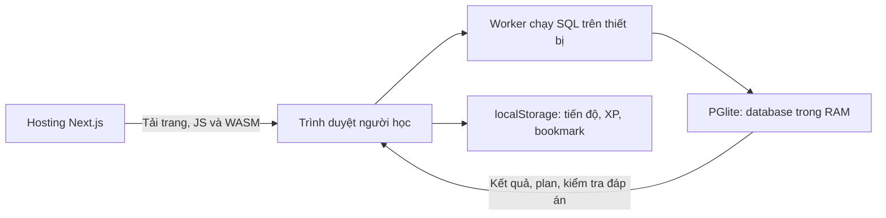
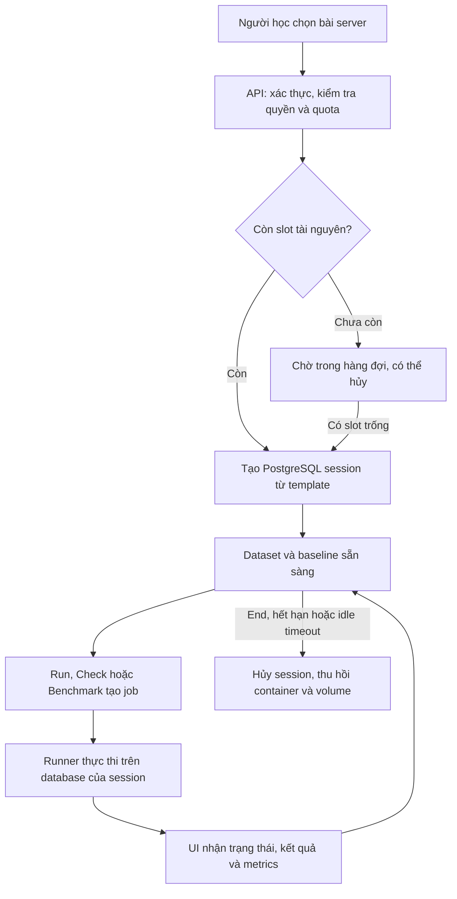

# DataLab đang làm gì và sẽ scale như thế nào?

> **Cập nhật implementation 08/10/2026:** đã có 14 bài theo câu chuyện, theme sáng/tối, bài partition thực và prototype PostgreSQL riêng. Các mô tả/đánh giá trước triển khai trong tài liệu này được giữ làm bối cảnh; đối chiếu [chức năng hiện có](current-features.md) và [hướng dẫn native](native-connector-setup.md) để biết phần đã hoàn thành. Hosted labs, account, cloud relay bền vững và SQL builder vẫn là mục tiêu.

Đối chiếu code ngày **08/10/2026**. Tài liệu này giải thích từ góc nhìn người học và người vận hành. Những phần ghi **hiện tại** đã có trong repo; những phần ghi **đề xuất** cần xây thêm. Các ví dụ capacity, thời gian và tiền bên dưới là giả định để hiểu cách tính, không phải kết quả benchmark hay báo giá.

**Bổ sung hướng thiết kế mới:** người học cài dataset vào PostgreSQL của họ, web tự lấy plan qua connector và trực quan hóa/hướng dẫn. Xem [lab trên database của người học](own-database-labs-design.md). Phần VPS/session/queue bên dưới mô tả phương án khác: DataLab tự host database cho learner.

## 1. Hiện tại sản phẩm làm gì?

DataLab là **website học SQL và cách tối ưu truy vấn PostgreSQL bằng thực hành**. Người học nhận đề bài, viết SQL, chạy trên dữ liệu mẫu, xem database xử lý thế nào rồi kiểm tra đáp án. Mục tiêu là hiểu vì sao một truy vấn đúng, vì sao nó đọc nhiều dữ liệu và khi nào thêm index hoặc sửa SQL có ích.

Bản hiện tại có 12 bài: SELECT/WHERE, GROUP BY, JOIN, window function, table scan, index, composite index, LIKE, EXPLAIN, tối ưu query, pagination và một tình huống incident. Có khu thử SQL tự do, phỏng vấn thử, hints, lời giải, XP và tiến độ học. Mọi bài hiện mở miễn phí, không cần tài khoản.

### Ví dụ: người học mở bài tạo index

1. Người học vào `/labs/index-006`.
2. Trình duyệt tải code và engine PGlite. PGlite là PostgreSQL được đóng gói để chạy trong trình duyệt bằng WebAssembly, thường viết tắt là WASM.
3. Website tạo database riêng trong RAM của thiết bị đó: 1.000 customers, 100 products, 50.000 orders và 100.000 order_items. Tổng cộng **151.100 dòng**.
4. Website chạy query ban đầu để ghi nhận mốc so sánh, gọi là **baseline**:

   ```sql
   SELECT *
   FROM orders
   WHERE customer_id = 42;
   ```

5. Người học xem plan và thấy cách PostgreSQL tìm đơn hàng. Khi chưa có index trên `customer_id`, bài này được thiết kế để quan sát quét bảng.
6. Người học thêm index rồi chạy lại cùng SELECT:

   ```sql
   CREATE INDEX idx_orders_customer ON orders (customer_id);

   SELECT *
   FROM orders
   WHERE customer_id = 42;
   ```

7. Website hiển thị plan mới, thời gian thực thi và lượng công việc đọc dữ liệu trước/sau. PostgreSQL tự chọn cách dùng index phù hợp với dataset.
8. Khi bấm kiểm tra, validator xác nhận toàn bộ kết quả vẫn đúng, có index phù hợp, plan dùng index và lượng tuple work trên `orders` giảm ít nhất 80% so với baseline. Tuple work ở đây là số lượt xử lý/kiểm tra dòng xấp xỉ suy ra từ các node truy cập bảng trong plan. Điều kiện 80% của bài này đo công việc trong plan, không yêu cầu mọi thiết bị đều nhanh hơn 80% theo mili giây.
9. Nếu đạt, tiến độ và XP được ghi trong localStorage của trình duyệt. Reload sẽ dựng lại database; tiến độ đã hoàn thành vẫn còn nếu storage còn nguyên.

**Kết quả SQL, index và execution plan trong luồng này là thật.** Dữ liệu là dữ liệu mẫu tự sinh để học. Khi tạo index, bạn đang thay đổi database tạm của bài học trên thiết bị mình.

Nguồn đối chiếu: [nội dung bài](../content/labs.ts), [workspace](../components/lab-workspace.tsx), [engine](../lib/engine/core.ts), [generator dữ liệu](../lib/engine/seed.ts).

## 2. Dữ liệu và công việc nằm ở đâu?



| Thành phần | Đang nằm ở đâu? | Dùng để làm gì? | Sau reload/rời bài |
| --- | --- | --- | --- |
| Trang, editor, nội dung bài | Hosting phục vụ code; browser hiển thị | Đề bài, điều hướng, nhập SQL | Tải lại từ website |
| Database bài học | RAM của thiết bị người học, trong Worker | Chạy SQL, giữ dataset và index đang thử | Bản cũ bị bỏ; dựng lại khi mở bài |
| Plan, baseline, query đang viết | Trạng thái của workspace | So sánh và phản hồi trong lần làm | Chưa được lưu lâu dài |
| Tiến độ, XP, bookmark | localStorage theo domain/trình duyệt | Nhớ bài đã hoàn thành | Còn nếu storage không bị xóa |
| Tài khoản và tiến độ cloud | Chưa có | Sau này dùng để học trên nhiều thiết bị | Chưa triển khai |
| PostgreSQL server cho learner | Chưa có | Sau này chạy bài nặng trên máy chủ | Chưa triển khai |

**Worker** là nơi chạy công việc nền của trình duyệt để SQL không thực thi trên luồng giao diện. Worker vẫn dùng CPU/RAM của cùng thiết bị; nó không phải một server và không cấp thêm RAM cho bài học.

Máy A tạo index không ảnh hưởng máy B. Mở hai workspace ở hai tab tạo hai database riêng nhưng cả hai cùng tiêu thụ tài nguyên của thiết bị đó. Bản hiện tại không có API gửi SQL tới database từ xa.

Đổi máy hoặc đổi domain không tự mang tiến độ theo. Chức năng export hiện có giúp lấy JSON tiến độ; import và đồng bộ chưa có. Xem [kiến trúc và dữ liệu](architecture-and-data.md) để biết vòng đời chi tiết.

## 3. Trong docs, “scale” có những nghĩa nào?

“Scale” là tăng quy mô mà hệ thống vẫn đáp ứng được. Phải nói rõ tăng cái gì, vì các nhu cầu dưới đây tạo ra những vấn đề khác nhau:

| Loại tăng quy mô | Ví dụ | Bản hiện tại đáp ứng thế nào? | Việc phải giải quyết tiếp |
| --- | --- | --- | --- |
| Tăng người truy cập/học | Nhiều người cùng mở web và làm 12 lab | Mỗi thiết bị tự chạy SQL; hosting phục vụ trang/assets | Đo tải web, traffic/WASM, lỗi khởi tạo, trải nghiệm trên thiết bị yếu |
| Tăng dữ liệu trong một lab | Từ 50K lên 1M hoặc 10M orders | Playground chỉ hỗ trợ tối đa 100K orders thật | Seed/clone, RAM, SSD, index, thời gian chạy; thêm lab server nếu cần |
| Tăng tải database trong một thí nghiệm | 20 connection cùng chạy query để đo độ trễ | Worker hiện xử lý tuần tự trên một connection | Workload thật, connection budget, lock/I/O và metrics trên server |
| Tăng session server của nhiều người học | 10 người cùng cần database riêng | Chưa có server session | Slot, quota, hàng đợi, cleanup và phân phối session lên nhiều host |
| Tăng nội dung và dịch vụ tài khoản | 100 bài, cloud sync, gói trả phí | Nội dung trong code; tiến độ local | Version nội dung, auth, App DB, sync và quyền truy cập phía server |

Ví dụ: 1.000 người cùng làm lab browser không tạo 1.000 PostgreSQL container trên hạ tầng của bạn. Mỗi người dùng thiết bị mình để chạy SQL. Điều này giảm phần compute SQL tập trung, nhưng **chưa có load test để cam kết website phục vụ được 1.000 người đồng thời**.

Khi chuyển sang **lab do DataLab host**, compute SQL của những session đó chuyển sang hạ tầng của bạn. Lúc này thêm người làm bài đồng thời có thể cần thêm CPU/RAM/SSD hoặc phải chờ slot.

Nếu chọn **database của người học**, PostgreSQL native chạy trên máy/server của họ; DataLab không cấp slot database. Công việc cần xây là dataset/generator, connector, API relay và trực quan hóa. Người học đổi sự tiện lợi mở web ngay lấy khả năng thực hành môi trường native và phải chuẩn bị tài nguyên/cài đặt.

## 4. Slider 10K–1B dòng đang làm gì?

Slider trong workspace là **mô hình minh họa tăng trưởng chi phí truy vấn**. Kéo tới 1B không tạo một tỷ dòng, không đổi dataset đang có và không gửi job đi benchmark một tỷ dòng.

Code [ScaleSimulation](../components/lab-workspace.tsx) tính hai giá trị, đơn vị mili giây:

```text
N0 = số orders thật trong workspace
N  = số dòng chọn trên slider
t0 = max(0,1 ms, executionMs của baseline || 5 ms)

Ước tính scan   = t0 × N / N0
Mô hình lookup  = max(0,01 ms, 0,15 ms × log2(N) / log2(N0))
```

Theo biểu thức `executionMs || 5`, thiếu giá trị hoặc giá trị bằng 0 sẽ dùng 5 ms. Hệ số **0,15 ms** của lookup là hằng số minh họa, không được đo từ index người học vừa tạo. Baseline cũng không được kiểm tra bắt buộc phải là một sequential scan trước khi dùng trong công thức này.

Ví dụ giả định baseline 5 ms với 50.000 orders: slider 1 triệu sẽ cho scan 100 ms; slider 1 tỷ sẽ cho scan 100.000 ms, tức 100 giây. Đó là kết quả nhân tỷ lệ trong mô hình, không phải số đo PostgreSQL trên dataset lớn.

Điều mô hình muốn dạy là quét toàn bảng có lượng công việc tăng theo số dòng, còn cấu trúc tìm kiếm có thể giúp tránh đọc phần lớn bảng. Thời gian thật còn phụ thuộc lượng kết quả phải trả, độ chọn lọc, cache, I/O, plan, index, độ rộng dòng và tải khác. Query trả rất nhiều dòng vẫn tốn công đọc/trả kết quả dù có index. Không dùng slider để chọn cấu hình server hoặc hứa latency cho khách hàng.

## 5. Vì sao tăng dataset browser mãi không giải quyết được?

Giới hạn hiện tại phục vụ một bài học vừa phải: tối đa 100K orders, tương ứng **301.100 dòng cả bốn bảng**. Engine dùng `memory://`; nó không cấu hình lưu dataset lâu dài trên đĩa. Chưa đo để khẳng định một dataset lớn hơn sẽ phù hợp với mọi thiết bị.

| Giới hạn | Tác động khi tăng quy mô |
| --- | --- |
| RAM của thiết bị | Bảng, index và kết quả trung gian của JOIN/sort/validator đều cần tài nguyên; một query có thể tốn nhiều hơn kích thước dữ liệu gốc |
| Thời gian dựng dữ liệu | Mỗi workspace phải dựng lại fixture; tăng số dòng có thể khiến chờ lâu hoặc vượt watchdog khởi tạo 45 giây |
| Thời gian query | Transaction đọc đặt statement timeout 4,5 giây; request query có watchdog 8 giây. Đây là hai giới hạn khác nhau |
| Khác biệt phần cứng/cache | Cùng query có thể nhanh trên desktop, chậm trên điện thoại; thời gian local chưa chứng minh latency trên server |
| Cách thực thi | Một connection với các request tuần tự chưa thể tạo workload nhiều connection tranh tài nguyên trong cùng database |
| Phạm vi bài tập | Guard hiện giới hạn query đọc và index; bài transaction ghi dữ liệu, deadlock hoặc tải production cần thêm cơ chế thực thi |
| Số đo I/O và incident | Buffer trong WASM không đại diện đầy đủ I/O production; CPU/p95/connections trong bài incident hiện là dữ kiện tình huống |

Preview 200 dòng giới hạn dữ liệu hiển thị. Nó không giới hạn toàn bộ công việc của SQL: `EXPLAIN ANALYZE` chạy query để lấy plan thực, còn validator so sánh toàn bộ kết quả trong PostgreSQL. Một query trả 10 dòng vẫn có thể đọc rất nhiều dòng trước đó.

Worker và timeout hỗ trợ phục hồi nhưng chưa có hard memory quota ở cấp hệ điều hành. Chỉ đổi `DatasetSize` sang 1 triệu hoặc nâng timeout sẽ không tự bổ sung workload nhiều connection, isolation hay đo I/O server.

## 6. Lab do DataLab host sẽ thay đổi trải nghiệm thế nào? — Đề xuất

Giữ bài cơ bản chạy browser. Với bài cần dữ liệu lớn, index lớn, disk I/O, transaction/locks hoặc nhiều connection, người học bấm **Start server lab** và nhận một database tạm trên hạ tầng của bạn.



**Session** là lần sử dụng database tạm của người học. **Job** là một công việc trong session, như chạy query hoặc benchmark. **Slot** là phần tài nguyên mà hệ thống cho phép cấp cho một session hoặc benchmark; không đồng nghĩa một user đăng ký.

| Thành phần đề xuất | Vì sao cần? |
| --- | --- |
| App PostgreSQL | Lưu lâu dài account, progress, chủ sở hữu session, job và kết quả cần giữ |
| PostgreSQL instance/container cho từng session | Giữ dataset/index/trạng thái riêng để người học thử nghiệm |
| Lab API/gateway | Kiểm tra ai được tạo, chạy, xem kết quả, reset hoặc hủy session |
| Redis + BullMQ | Xếp và điều phối job, hiển thị chờ, hạn chế công việc chạy đồng thời |
| Runner | Nhận job, kết nối database đúng session, thực thi và kiểm tra đáp án |
| Provisioner | Tạo/reset/hủy container và volume từ cấu hình đã duyệt |
| pgbench | Tạo nhiều client/transaction thật để đo latency/throughput dưới tải |
| Quota và cleanup | Giới hạn tài nguyên, thu hồi session hết hạn hoặc bị bỏ sau lỗi |

SQL của learner chỉ được chạy trong database lab của session đó. App DB giữ dữ liệu sản phẩm phải được tách quyền và không nhận SQL của learner.

Thiết kế pilot chọn một PostgreSQL instance/container mỗi session. Nhiều container có thể chạy trên cùng VPS; chúng vẫn chia sẻ CPU/SSD của host. Tách container giúp kiểm soát session, nhưng cần resource limits và chính sách benchmark để hạn chế ảnh hưởng lẫn nhau.

Dataset server khởi đầu đề xuất là 1 triệu orders, 3 triệu order_items, khoảng 100K customers và 10K products: khoảng **4,11 triệu dòng**, không phải chỉ 1 triệu dòng tổng. Chuẩn bị template trước rồi clone/restore cho từng session. Dataset này chưa có trong code.

UI gửi job và nhận ID, sau đó lấy trạng thái/kết quả. Request web không chờ suốt benchmark nhiều phút. Chấm bài server phải dùng đề, reference SQL và rules do backend quản lý. Có interface `DatabaseAdapter` hiện tại để làm điểm mở rộng, nhưng vòng đời session/job server vẫn phải thiết kế và triển khai thêm.

## 7. Một VPS chịu được bao nhiêu người? Phải đếm đúng thứ

| Con số | Ý nghĩa |
| --- | --- |
| User đăng ký | Số tài khoản, phần lớn có thể đang offline |
| Người đang xem web | Tải UI/assets, có thể đang đọc đề hoặc làm lab browser |
| Session server đang sống | Database đã được cấp; vẫn chiếm RAM/disk dù người học đang đọc đề |
| Query/benchmark đang chạy | Công việc đang tiêu thụ CPU/I/O; chỉ là một phần của các session đang sống |
| Client trong pgbench | Số client tạo tải vào database của một thí nghiệm |

**50 client pgbench trong một session không có nghĩa 50 learner được cấp 50 database riêng.** Vì vậy “có 1.000 user” chưa đủ để tính VPS: phải biết bao nhiêu người cùng giữ session, bao nhiêu job nặng cùng chạy và mỗi job cần gì.

Ví dụ giả định: host có 12 GB RAM; reserve 4 GB cho OS, App DB, API/queue/runner và headroom; còn 8 GB. Nếu mỗi session được cấp quota 2 GB, RAM cho phép tối đa **4 session**, với điều kiện CPU, disk và I/O cũng đủ. Đây chưa phải bằng chứng có thể chạy 4 benchmark cùng lúc.

Pilot đề xuất chỉ một benchmark nặng hoạt động mỗi host. Trong ví dụ trên, 4 session có thể đã sẵn sàng, nhưng nếu cả 4 cùng bấm Benchmark thì một job chạy, ba job chờ. Nếu dùng chính sách một benchmark nặng để giảm nhiễu, các query và công việc clone nền gây I/O đáng kể cũng phải được kiểm soát; chỉ giới hạn số benchmark là chưa đủ.

Các giới hạn phải phối hợp:

- **RAM:** tính peak của query, tạo index, validator và load generator; chừa headroom thay vì cấp toàn bộ RAM máy cho session.
- **CPU:** quota và số job nặng được chạy; đạt trần CPU có thể làm nhiều session chậm đồng thời.
- **Disk:** template + từng clone + index + WAL + temp files + dự phòng. Đo GB thật thay vì suy ra từ số dòng.
- **I/O:** clone hoặc sort nhiều session có thể làm SSD thành nút thắt trước khi RAM/CPU đầy.
- **Connection:** phối hợp pool của runner, pgbench clients và giới hạn của PostgreSQL từng session.
- **Thời gian giữ slot:** TTL/idle timeout và cleanup quyết định tài nguyên được quay vòng nhanh hay chậm.

Hàng đợi giúp hệ thống từ chối cấp thêm tài nguyên khi hết sức chứa. Nó **không tăng năng lực xử lý**. Ví dụ giả định một benchmark mất 2 phút, chạy một job mỗi lần, bỏ qua mọi overhead: trần lý thuyết là 30 job/giờ. Nếu nhu cầu kéo dài ở 60 job/giờ, số job chờ sẽ tăng; phải giảm công việc, giới hạn nhu cầu hoặc bổ sung năng lực. Với 10 job đến cùng lúc và slot trống ban đầu, job cuối chờ khoảng 18 phút trước khi bắt đầu theo các giả định đó.

Capacity thực phải được đo từ lúc tạo session tới cleanup, đồng thời theo dõi thời gian chờ, lỗi, timeout và mức ổn định của benchmark. Công thức dự toán ở [deploy và chi phí](deployment-and-costs.md#3-tài-nguyên-ban-đầu-và-capacity).

## 8. Khi một VPS không đủ, mở rộng thế nào? — Đề xuất sau pilot

**Bước đầu: đo nút thắt rồi tăng tài nguyên đúng chỗ.** Nếu RAM đầy nhưng CPU còn dư, thêm vCPU chưa chắc tăng được session. Nếu I/O đang gây chậm, thêm runner chưa chắc tăng throughput. Nâng một host có thể đơn giản hơn thêm nhiều host ở giai đoạn đầu.

**Bước tiếp: thêm host chạy lab.** Mỗi host có tài nguyên và runner/provisioner riêng; tầng điều phối quyết định session nằm trên host nào. Ví dụ bố trí:

```text
Web + account/API + App DB + queue
                 |
          Bộ điều phối slot
            /          \
  Host A: session 1,2   Host B: session 3,4
```

Thiết kế hiện có trong docs mới tập trung pilot một máy. Mở rộng nhiều máy phải bổ sung ít nhất:

1. **Thông tin và đặt chỗ trên host:** theo dõi host còn bao nhiêu slot, có khỏe không; đặt chỗ có kiểm soát để hai request không cùng cấp vượt tài nguyên.
2. **Định tuyến theo session:** lưu `sessionId → hostId`; Run/Reset/End phải đến đúng nơi có database đó. Không đưa query của session A cho một runner bất kỳ không truy cập được session A.
3. **Giữ quyền xử lý job:** lease/heartbeat, kiểm tra ownership và tuần tự hóa thao tác xung đột; tránh cùng một session bị benchmark và reset đồng thời.
4. **Phân phối template:** pin dataset/PostgreSQL version và chuẩn bị template trên host mới; đưa thời gian/dung lượng này vào kế hoạch cấp máy.
5. **Thu hồi sau lỗi:** đối chiếu metadata với container/volume thật, dọn resource mồ côi; host hỏng thì báo session thất bại và cho dựng lại theo chính sách đã chọn.
6. **Điều kiện đo nhất quán:** ghi loại host, quota, cache/workload config; so baseline/after trên cùng session và điều kiện tương đương. Không coi timing giữa các máy khác nhau là một cuộc thi công bằng.

App DB, queue, API và lab compute cũng có thể được tách host khi cần. Tăng số runner vẫn bị giới hạn bởi nơi thật sự chạy PostgreSQL và tạo tải.

Autoscale hạ tầng nghĩa là tự cấp/hủy **máy thuê** theo nhu cầu. Tạo thêm container trên một VPS cố định chỉ sử dụng phần tài nguyên còn lại của VPS đó. Container không tạo thêm CPU/RAM vật lý. Chưa có scheduler nhiều host, autoscaling hay capacity được kiểm chứng trong repo; các phần này là thiết kế phải xây khi pilot cho thấy cần.

## 9. Scale liên quan gì tới chi phí và gói trả phí?

Bản browser hiện tại cần hosting web/assets; compute SQL do thiết bị learner thực hiện. Bản server bổ sung compute/RAM/SSD để chạy database, template/clone, backup App DB và công việc vận hành. Tự host Redis, PostgreSQL và runner trên cùng máy không có nghĩa phải thuê một VPS riêng cho mỗi tên công nghệ.

Với mô hình thuê VPS cố định theo tháng, hủy session giải phóng slot và disk tạm để phục vụ người tiếp theo. Khoản thuê máy theo tháng vẫn còn. Khi thêm host mới để tăng capacity, dự toán phải tính thêm tài nguyên và thời gian máy tồn tại.

Ví dụ ngân sách **tự đặt để minh họa**, không phải bảng giá: tổng hạ tầng server 1.200.000đ/tháng. Nếu hoàn thành 400 session/tháng, bình quân 3.000đ/session; nếu chỉ 40 session, bình quân 30.000đ/session. Mẫu số khác nhau tạo chi phí bình quân khác nhau dù cùng thuê một máy. Đây chỉ là phân bổ hạ tầng, chưa gồm công sức vận hành, hỗ trợ và các chi phí khác.

Khi định nghĩa Pro/Lifetime cần tách quyền học nội dung khỏi quota sử dụng tài nguyên server: số session đồng thời, thời lượng session, dataset profile và benchmark budget. Một lần mua nội dung không tự xác định được ngân sách compute có thể dùng mãi. Quota cụ thể cần dựa vào số đo và mô hình kinh doanh; giá đang hiển thị trên trang pricing mới là đề xuất và checkout chưa có.

Các con số 4 vCPU, 8–16 GB RAM, 100–160 GB SSD trong docs là mức khảo sát pilot, không phải cấu hình đã chứng minh đủ cho X người. Giá provider phải kiểm tra lúc lựa chọn/mua; tài liệu này không dùng báo giá hiện hành.

## 10. Thứ tự làm tiếp và cách biết đã giải quyết được vấn đề

| Giai đoạn | Công việc cụ thể | Bằng chứng cần có trước khi tăng quy mô |
| --- | --- | --- |
| Beta browser hiện tại | Kiểm tra luồng học trên hosting và thiết bị mục tiêu; quan sát lỗi, thời gian vào lab, khả năng hoàn thành | Đo tải engine/seed, lỗi và phản hồi từ người học; không dùng slider làm benchmark |
| Account nếu cần sync | Auth, App DB, merge tiến độ anonymous và phân quyền | Học trên hai thiết bị thấy tiến độ đúng; ghi nhận completion không trùng |
| Server prototype local | Một bài index dữ liệu lớn, một bài dưới tải; session riêng, template, runner, queue và cleanup | Dataset/validator đúng; session không truy cập nhau; đo RAM/disk/CPU/I/O và phục hồi lỗi |
| Pilot một VPS | Chốt quota/slot từ số đo, TTL, backup App DB, benchmark có kiểm soát | Queue wait chấp nhận được, host ổn định, reset/end/crash dọn sạch, biết chi phí thực |
| Nhiều host khi cần | Scheduler, định tuyến session, template versions, lease/heartbeat, theo dõi tài nguyên | Job chạy đúng host, không cấp vượt slot, host lỗi được xử lý và thêm host cải thiện bottleneck đã đo |
| Mở gói trả phí khi triển khai | Checkout/webhook, entitlement server, quota, điều kiện sử dụng | Quyền trả phí và giới hạn compute được thực thi từ backend |

Server labs là **khả năng bổ sung để học performance ở điều kiện browser hiện chưa tái hiện được**. Tăng lượt truy cập cho 12 bài browser và xây server labs là hai nhánh công việc riêng. Chọn nhánh nào dựa trên nhu cầu người học và số đo thực tế.

## 11. Các thuật ngữ trong docs nghĩa là gì?

| Thuật ngữ | Hiểu trong hệ thống này |
| --- | --- |
| Dataset / fixture | Bộ dữ liệu mẫu có schema và các dòng để làm bài |
| Execution plan | Cách PostgreSQL chọn đọc bảng/index, JOIN, sort và xử lý query |
| Baseline | Số đo và plan ban đầu để so với lần tối ưu |
| Validator | Phần kiểm tra kết quả và các điều kiện hoàn thành bài |
| Workload | Tập query/transaction chạy theo cấu hình tải của thí nghiệm |
| Benchmark | Lần chạy có kiểm soát để đo hệ thống dưới workload đó |
| Latency / p95 | Độ trễ; p95 là ngưỡng mà khoảng 95% mẫu có độ trễ không vượt quá. Cần nhiều mẫu từ workload, không suy ra từ một lần chạy query |
| Throughput | Số công việc/transaction hoàn thành trong một đơn vị thời gian |
| Quota | Giới hạn tài nguyên hoặc mức sử dụng được cấp cho session/user |
| TTL / idle timeout | Thời gian sống tối đa / thời gian không hoạt động trước khi session bị thu hồi |
| Provision / template / clone | Cấp môi trường / bản dữ liệu chuẩn bị trước / bản riêng cấp cho session |
| Cleanup / sweeper | Thu hồi tài nguyên / tác vụ rà và dọn phần bị bỏ sót sau lỗi |
| Host / VPS | Máy chủ chạy các service và container, với CPU/RAM/SSD hữu hạn |
| Scheduler | Bộ điều phối chọn host và cấp slot phù hợp cho session/job |
| Lease / heartbeat | Quyền xử lý có hạn phải duy trì / tín hiệu định kỳ để biết worker hoặc host còn hoạt động |

Đọc tiếp: [chức năng hiện có](current-features.md), [kiến trúc và dữ liệu](architecture-and-data.md), [công nghệ](technology-stack.md), [thiết kế server labs](server-labs-design.md), [deploy và chi phí](deployment-and-costs.md). [Prompt bổ sung](prompt-addendum.md) là yêu cầu mục tiêu, nên có những tiêu chí chưa triển khai hoặc khác giới hạn hiện tại.
