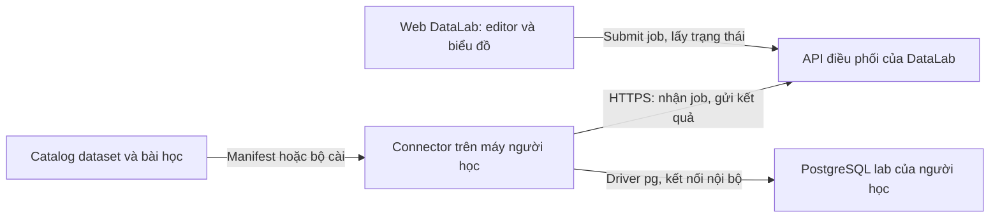

# Lab trên database của người học: kết nối, hướng dẫn SQL và trực quan hóa

**Trạng thái: đã có prototype local một phần, các mục mở rộng vẫn là thiết kế.** Cập nhật ngày **08/10/2026**. Đã triển khai connector PostgreSQL polling, ghép nối, chạy/chấm/reset/cancel, dataset tới 1M orders, câu chuyện và plan/partition trực quan. Chưa có relay cloud bền vững, installer, SQL builder, tài khoản hoặc MySQL. Xem [hướng dẫn chạy hiện tại](native-connector-setup.md). PostgreSQL được ưu tiên theo lựa chọn của người dùng.

## 1. Ý tưởng sản phẩm

DataLab cung cấp dataset, bài học, query mẫu, editor, phân tích và biểu đồ. Người học cài dataset vào PostgreSQL riêng trên máy hoặc server họ quản lý. Khi bấm chạy trên web, SQL thực thi trên database đó; web hiển thị kết quả và giải thích.

Lợi ích chính: người học tự thử query/index trên dataset lớn và môi trường PostgreSQL native, không phụ thuộc slot database do DataLab thuê. Mỗi người thay đổi dữ liệu/index của mình. Chủ web không cần giữ một bản database lớn luôn chạy cho mỗi learner.

Đổi lại, người học cần cài database/connector, có RAM/SSD/CPU phù hợp và chờ dựng dataset ban đầu. Dataset một tỷ dòng vẫn rất nặng trên máy họ; chuyển nơi thực thi không làm dữ liệu lớn trở nên nhẹ. Giữ **Học ngay trong browser** cho người mới; **Thực hành trên PostgreSQL của tôi** là chế độ nâng cao.

## 2. Ba mô hình có thể cùng tồn tại

| Chế độ | Database và query nằm ở đâu? | Người học chuẩn bị gì? | Vai trò DataLab |
| --- | --- | --- | --- |
| Browser hiện tại | PGlite trong RAM thiết bị | Mở web | Nội dung, editor, validator và plan local |
| Database của người học — ưu tiên thiết kế tiếp | PostgreSQL native trên máy/server của họ | Cài connector và dataset, hoặc chọn database lab đã có | Dataset/lesson, điều phối lệnh, hiển thị và hướng dẫn |
| Hosted server lab — phương án tùy chọn | PostgreSQL session trên hạ tầng DataLab thuê | Mở web, nhận session theo capacity | Cấp tài nguyên, vận hành và toàn bộ trải nghiệm học |

Database ứng dụng để lưu account/progress vẫn là phần khác. Chế độ database riêng không tự triển khai đăng nhập hoặc đồng bộ; hiện progress còn ở localStorage.

## 3. Vì sao cần connector?

Website thông thường không có API TCP tùy ý để nói trực tiếp giao thức PostgreSQL/MySQL chỉ bằng cách nhập `localhost:5432` hay `localhost:3306`. WebSocket nói chuyện với WebSocket server, không thay thế PostgreSQL/MySQL driver. Direct Sockets của Chrome là capability dành cho Isolated Web Apps, không phải khả năng mặc định của website thông thường. [Chrome Direct Sockets](https://developer.chrome.com/docs/iwa/direct-sockets), [MDN WebSocket](https://developer.mozilla.org/en-US/docs/Web/API/WebSocket).

Backend DataLab cũng không thể dùng `localhost` của nó để truy cập database trên laptop người học. Vì vậy cần một **connector**: chương trình nhỏ chạy gần database, có driver PostgreSQL và cầu nối tới web.

### Kiến trúc ưu tiên: connector kết nối ra ngoài



Connector chủ động kết nối tới API qua HTTPS. Bản đầu có thể dùng polling; bổ sung WebSocket khi cần phản hồi nhanh hơn. PostgreSQL giữ trong mạng riêng của người học. Mật khẩu database được lưu tại connector, không nhập vào localStorage hoặc gửi lên cloud DataLab.

Luồng ghép nối đề xuất:

1. Người học cài connector và chọn PostgreSQL lab trên máy hoặc mạng họ truy cập được.
2. Connector lấy mã ghép nối ngắn hạn; người học nhập mã đó trên web.
3. API gắn phiên web với đúng connector; người học thấy tên kết nối, engine/version, dataset và trạng thái.
4. Khi Run, web gửi job; connector nhận job của đúng phiên, kiểm tra policy rồi thực thi.
5. Connector gửi preview có giới hạn, plan, metrics và feedback; web vẽ biểu đồ.
6. Ngắt kết nối/hủy ghép nối thì connector ngừng nhận job của phiên đó. Database local không tự bị xóa khi đóng web.

Ghép nối có thể dùng phiên anonymous cho prototype; khi thêm account cần kiểm tra ownership và hỗ trợ thu hồi token. Mã ghép nối không phải mật khẩu database. API chỉ cấp các loại job đã thiết kế, không có job tùy ý chạy shell hoặc nhận host/password mới từ browser.

Với luồng relay này, **SQL, plan và phần kết quả đã giới hạn đi qua API DataLab**. Cần hiển thị rõ và giới hạn thời gian lưu. Việc giữ mật khẩu ở local không có nghĩa mọi dữ liệu query đều không rời thiết bị. Một biến thể phục vụ cả UI tại localhost có thể giảm relay nhưng cần thiết kế riêng cho tài khoản/origin; chưa thuộc bản đầu.

## 4. Dựng dataset một lần, học nhiều bài

Người học dùng database/schema dành riêng cho lab. Dataset chuẩn phải có phiên bản, engine/PostgreSQL version đã kiểm chứng, seed/generator, phân phối dữ liệu, số dòng, index ban đầu và kiểm tra tính nhất quán.

Đề xuất ba profile để khảo sát: **100K, 1M và 10M orders**. Đây là profile cần xây/đo, ngoài fixture browser hiện có; phải công bố số dòng cả bảng liên quan và dung lượng thực sau import. Một tỷ dòng là mục tiêu nghiên cứu sau, không chọn mặc định cho máy người học.

Hai cách phân phối:

- **Dump/data files có phiên bản:** dễ tái lập, nhưng tải/import cần thời gian và traffic. Cung cấp checksum và tiến độ import.
- **Generator deterministic chạy tại connector:** tránh tải một file dữ liệu quá lớn, nhưng vẫn cần CPU/I/O, thời gian seed và kiểm tra đầu ra. Generator và profile phải được version.

Wizard nên phát hiện PostgreSQL, kiểm tra quyền trên schema lab, đo dung lượng cần thiết từ profile đã kiểm chứng, dựng dữ liệu rồi cập nhật statistics. Cho pause/retry theo quy trình import thiết kế và không bắt đầu lại vô ích sau lỗi có thể phục hồi. Có CLI và generator SQL deterministic cho native; chưa có installer đóng gói hoặc wizard import hỗ trợ pause/resume.

Giữ dữ liệu sau lần học để lần sau vào bài nhanh. Setup bài tạo trạng thái ban đầu theo manifest: index nào có sẵn, index nào learner được tạo/drop. Reset index của bài có thể nhẹ hơn restore toàn bộ dataset; nếu bài sửa dữ liệu thì phải có quy trình khôi phục phù hợp. Không mặc định full reset cho mọi bài.

Hai phiên cùng trỏ tới một schema lab vẫn có thể ảnh hưởng nhau. Bản đầu nên chỉ cho một phiên điều khiển schema đó tại một thời điểm; mở tab mới xem được trạng thái nhưng không chạy thao tác xung đột đồng thời.

## 5. Người học không phải viết EXPLAIN

Editor chứa SELECT hoặc SQL mẫu của bài. Các thao tác chính:

| Thao tác | Người học thấy gì? | Connector làm gì? |
| --- | --- | --- |
| **Xem cách database sẽ chạy** | Plan ước tính, chưa có thời gian thực thi | `EXPLAIN (FORMAT JSON)` cho query đọc được hỗ trợ |
| **Chạy và phân tích** | Plan thực, số đo và preview | `EXPLAIN (ANALYZE, BUFFERS, FORMAT JSON)` rồi lấy preview có giới hạn |
| **Thử index này** | SQL tạo index và phạm vi thay đổi trước khi chạy | Tạo index trong schema lab khi learner chọn thực thi, sau đó lấy lại catalog |
| **So sánh trước/sau** | Hai lần đo cùng query/dataset, giải thích thay đổi | Lưu baseline, chạy lại và kiểm tra kết quả vẫn đúng |
| **Dừng** | Trạng thái đang hủy/hủy xong | Hủy statement trên connection của job và kiểm tra trạng thái thực tế |
| **Đặt lại bài** | Index/trạng thái bài được phục hồi | Chạy quy trình setup/reset đã định cho schema lab |

`EXPLAIN ANALYZE` thực sự chạy SQL. Bản đầu chỉ tự phân tích query đọc thuộc phạm vi hỗ trợ; mutation/index là thao tác riêng do người học chọn. Có timeout, trạng thái progress và cancel cho query dài. [PostgreSQL EXPLAIN](https://www.postgresql.org/docs/current/sql-explain.html).

Preview và EXPLAIN ANALYZE là các thao tác khác nhau; query có thể được thực thi nhiều lần. Giới hạn preview 200 dòng không làm EXPLAIN hay validator chỉ xử lý 200 dòng. Tách **thời gian PostgreSQL**, **thời gian preview** và **thời gian qua connector/API**. Với profile lớn, có thể xem plan ước tính trước rồi chọn đo thực; không tự chạy benchmark nặng mỗi khi gõ.

Khi query, dataset, setup hoặc index thay đổi, gắn lần chạy với state/version thích hợp; bỏ response cũ. Không ghép chart của query mới với baseline của dataset cũ.

## 6. Thiết kế trực quan để dễ hiểu

Workspace vẫn có đề bài và editor nhưng ưu tiên **ba câu hỏi**: database đã làm gì, làm bao nhiêu việc, thay đổi nào có thể thử tiếp.

### Bố cục đề xuất

Wireframe này là thiết kế nội dung, chưa có màn hình kết nối trong app:

```text
[PostgreSQL của tôi: đã kết nối] [Dataset/profile] [Trạng thái]

Đề bài + schema      | SQL mẫu hoặc query đang viết
Mục tiêu + gợi ý     | [Xem plan] [Chạy và phân tích] [Dừng]

Database đã làm gì?  | Plan dạng cây, bấm node để xem giải thích
Làm bao nhiêu việc?  | Dòng đầu ra, lượt truy cập ≈, buffers, thời gian
Thử bước nào tiếp?   | Gợi ý + bằng chứng + [Đưa SQL vào editor]

[Kết quả] [So sánh trước/sau] [Chi tiết PostgreSQL]
```

### Biểu đồ nào giải thích điều gì?

| Biểu đồ / thành phần | Mục đích học | Nguồn dữ liệu và giới hạn |
| --- | --- | --- |
| **Cây execution plan** | Thấy scan, JOIN, sort, aggregate và quan hệ giữa bước xử lý | Node từ plan thật; giữ tên PostgreSQL và giải thích tiếng Việt khi chọn node |
| **Dòng vào/ra theo bước** | Hiểu query trả ít dòng vẫn có thể xử lý nhiều dữ liệu | Output rows, removed rows và loops khi có đủ counters; suy ra phải gắn dấu ≈, không áp một công thức cho mọi node |
| **Thanh trước/sau** | Đối chiếu thời gian, tuple work và buffers theo từng metric | Hai run cùng điều kiện; timing là số đo môi trường đó, không phải cam kết cho mọi máy |
| **Estimated vs actual rows** | Thấy planner ước lượng lệch ở đâu | Chỉ có actual sau ANALYZE; xử lý giá trị 0, không biến tỷ lệ vô hạn thành lỗi biểu đồ |
| **Buffer hit/read/temp** | Hiểu truy cập cache và công việc dùng vùng tạm | Counters PostgreSQL; read không tự đồng nghĩa đọc đĩa vật lý; counters cha có thể gồm con |
| **Danh sách index và cột** | Phân biệt index tồn tại với index được query sử dụng | Catalog + index name trong plan của từng bảng/node |
| **Sơ đồ table scan/B-tree** | Minh họa vì sao đường truy cập thay đổi | Gắn nhãn sơ đồ khái niệm, không mô tả là layout vật lý đọc từ database |
| **Phân phối dữ liệu theo filter** | Giúp hiểu độ chọn lọc của điều kiện | Chỉ từ thống kê hoặc query lấy mẫu có budget; ghi rõ estimated/sample/full measurement |

Không quy `Actual Rows` thành mọi dòng đã đọc. Xét loops và loại node; không cộng mọi node thành tổng công việc vì có thể đếm trùng. Không cộng thời gian của tất cả node để suy ra tổng query hoặc vẽ CPU % nếu chưa có dữ liệu phù hợp. Giữ JSON gốc để người học đối chiếu. [PostgreSQL Using EXPLAIN](https://www.postgresql.org/docs/current/using-explain.html), [EXPLAIN BUFFERS](https://www.postgresql.org/docs/current/sql-explain.html).

Màu và độ lớn node hỗ trợ chọn điểm cần xem, không kết luận rằng mọi sequential scan đều xấu. Trên mobile dùng các tab và bảng cuộn trong vùng riêng; chart có nhãn, đơn vị, bảng số liệu đi kèm và thao tác bàn phím. Animation minh họa không thay thế số đo.

## 7. Ví dụ luồng học index

Người học chọn bài **Tìm đơn hàng của một khách hàng**. Web điền sẵn:

```sql
SELECT id, order_date, total
FROM orders
WHERE customer_id = 42
ORDER BY id;
```

1. Bấm Chạy và phân tích. Connector lấy plan thật của dataset local; web không mặc định kết quả là Seq Scan nếu chưa chạy.
2. Nếu plan có Seq Scan trên orders, nhiều dòng bị lọc và chưa có index phù hợp, web nêu bằng chứng: query đang tìm nhóm khách hàng nhỏ nhưng phải kiểm tra nhiều dòng.
3. Gợi ý giải thích `orders.id` có index chưa chắc giúp điều kiện `customer_id`. Người học chọn đưa SQL thử nghiệm vào editor:

   ```sql
   CREATE INDEX idx_orders_customer ON orders (customer_id);
   ```

4. Người học chạy thao tác tạo index; UI hiển thị đang tạo, không hứa index lớn tạo tức thì. Sau đó chạy lại cùng SELECT.
5. Cây plan mới thể hiện loại scan PostgreSQL thực sự chọn: Index Scan, Bitmap hoặc lựa chọn khác. Chart so mốc trước/sau; nếu planner vẫn chọn quét bảng, giải thích dựa vào dữ liệu/độ chọn lọc/statistics thay vì tự coi thí nghiệm thành công.
6. Validator kiểm tra kết quả, index và yêu cầu plan/tuple work của bài. Hỏi thêm một câu: vì sao index này giúp điều kiện lọc? Người học có thể mở lời giải đã viết sẵn.

Dataset và câu hỏi phải có reference query đã kiểm chứng. Nếu thêm LIMIT hay rewrite để đổi ngữ nghĩa, không đánh giá là tối ưu thành công chỉ vì nhanh hơn. Không dùng các mốc ms cố định của một máy để chấm tất cả người học.

## 8. Giúp người chưa biết viết SQL

Đề xuất ba mức hỗ trợ:

- **Query mẫu của từng bài:** có SQL ban đầu, hints theo bước và lời giải kèm lý do. Đây là cách dễ kiểm chứng nhất cho bản đầu và tận dụng curriculum hiện tại.
- **SQL builder theo phạm vi bài:** chọn bảng, cột, điều kiện lọc, thứ tự hoặc nhóm; web tạo SQL có thể đọc/sửa. UI đối chiếu từng lựa chọn với đoạn SQL tương ứng. Giá trị và tên cột cần được xử lý đúng kiểu/cú pháp trong adapter.
- **Gợi ý từ plan:** tách thành quan sát → bằng chứng → cách thử → cách kiểm chứng. Nút gợi ý chỉ đưa SQL vào editor; không tự thay database.

Ví dụ: “Plan đang quét orders; phần lớn dòng bị loại bởi customer_id; có thể thử index trên customer_id rồi chạy lại cùng query để đối chiếu.” Đây là giả thuyết có bằng chứng cần kiểm tra, không đảm bảo index sẽ có ích cho mọi dataset.

Bản đầu dùng rules và nội dung do tác giả viết; không cần AI để vẽ plan hoặc cung cấp query mẫu. AI tutor có thể bổ sung sau, với dữ liệu gửi đi và budget được xác định riêng. Không gọi các câu giải thích theo rule là AI tự tối ưu SQL.

## 9. Thay đổi cần làm trong code

| Phần hiện có | Phần cần bổ sung |
| --- | --- |
| BrowserPostgresAdapter + Worker | Adapter kết nối qua connector/API, job IDs, progress, cancel và reconnect |
| DatasetSize chỉ 10K/50K/100K | Config/version/profile cho database native; số dòng và dung lượng từ manifest/metadata |
| QueryResult/ExplainDocument theo PostgreSQL | Giữ raw JSON, bổ sung provenance, engine/version, dataset version, run/query/state identity và buffer metrics |
| core.ts chạy PGlite | Runner native dùng `pg`; trusted catalog queries, policy query và index riêng |
| lab-workspace.tsx | Chọn kết nối, trạng thái import/job, hiển thị plan và chart cải tiến, SQL mẫu/builder |
| Validator local | Chạy/reference đầy đủ trên native dataset; kiểm chứng lại threshold/plan cho profile mới |
| Tiến độ localStorage | Tiếp tục dùng cho prototype; account/sync là nhánh riêng khi xây backend lưu progress |

Interface `DatabaseAdapter` hiện tại là điểm tái sử dụng, chưa đủ cho import, ghép nối, nhiều profile và job dài. Không đặt token/password vào curriculum hoặc bundle client. Node-postgres cung cấp driver/queries; connector/lifecycle đã có prototype; durability và vận hành cloud vẫn cần xây. [node-postgres queries](https://node-postgres.com/features/queries).

### Phạm vi quyền và khôi phục

Connector chỉ cho phép thao tác trên database/schema lab đã chọn ở máy người học, bằng role hạn chế. Query có policy và timeout; setup/import/index có quyền và vòng đời riêng. Client guard hiện tại là lớp bổ sung, connector cũng phải kiểm tra job. Không dùng database production hoặc role quản trị mặc định trong onboarding.

Lưu credential ở máy người học; API kiểm tra ownership/ghép nối ở submit, status, cancel và result. Preview/log có giới hạn và retention rõ. Disconnect giữa lúc chạy không có nghĩa query đã hủy: connector cần theo dõi job và xác nhận trạng thái thật khi nối lại. Index/DDL không tự retry chỉ vì mất response; kiểm tra catalog và trạng thái trước.

Người học quản lý database và connector nên có thể sửa dataset hoặc kết quả gửi về. Chấm này phục vụ luyện tập; chứng chỉ/điểm thi chống gian lận cần cơ chế kiểm chứng riêng. Không coi kiểm tra qua connector là hidden test đáng tin cậy mặc định.

## 10. MySQL là nhánh sau

Người dùng đã chọn PostgreSQL trước. Nếu thêm MySQL, cần dataset/setup/reference SQL, parser plan, catalog adapter và kiểm thử riêng. Không gửi cú pháp PostgreSQL `EXPLAIN (ANALYZE, BUFFERS, FORMAT JSON)` vào MySQL.

Ví dụ phạm vi **MySQL 8.4**: plan ước tính lấy qua `EXPLAIN FORMAT=JSON`; `EXPLAIN ANALYZE FORMAT=TREE` cho thông tin thực thi dạng cây, không hỗ trợ JSON cho ANALYZE ở phiên bản này. Chuẩn hóa sang mô hình UI chung nhưng giữ raw output và thông tin phiên bản. [MySQL 8.4 EXPLAIN](https://dev.mysql.com/doc/refman/8.4/en/explain.html).

MySQL Workbench đã có Visual Explain đọc JSON và vẽ query plan; đó là tiền lệ cho khả năng trực quan hóa. DataLab bổ sung luồng học, dataset, baseline, hints và kiểm tra đáp án. Đây là tham khảo chức năng, không khẳng định có thể nhập nguyên code Workbench vào app. [MySQL Workbench Visual Explain](https://dev.mysql.com/doc/workbench/en/wb-performance-explain.html).

## 11. Chi phí và nghiệm thu prototype

Chủ web còn chi phí hosting, phân phối dataset/generator, API relay, job metadata và App DB nếu có account. CPU/RAM/SSD của PostgreSQL do người học cung cấp. File dump lớn vẫn tạo traffic tải xuống; relay result quá lớn vẫn làm backend tốn tài nguyên. Không cần provision container PostgreSQL tại DataLab cho chế độ này, nhưng cần vận hành connector, protocol và hỗ trợ cài đặt.

Prototype đầu nên có một profile lớn đã đo và một bài index hoàn chỉnh. Nghiệm thu khi:

1. Người học ghép nối, dựng dataset và làm bài mà không phải gõ EXPLAIN; lỗi cài đặt/import có hướng phục hồi.
2. Mật khẩu DB giữ ở connector; SQL chỉ chạy trong schema lab của đúng phiên được ghép nối.
3. Plan/chart đối chiếu được với PostgreSQL gốc; estimated, measured và schematic có nhãn riêng, unsupported metric hiện chưa có dữ liệu.
4. Baseline/after cùng query/dataset và kết quả đúng; giải thích được index tồn tại khác index được dùng.
5. Timeout/cancel/disconnect/reset có trạng thái thật, không để job cũ thay chart mới hoặc thao tác hai tab xung đột.
6. Đo thời gian onboarding, import, lần chạy đầu, RAM/disk peak và mức người học hiểu bài trước khi mở profile 10M hay 1B.

Đọc cùng [hiện trạng](current-features.md), [stack](technology-stack.md), [phương án hosted server](server-labs-design.md), [deploy/chi phí](deployment-and-costs.md) và [đánh giá tiềm năng/độ sâu kiến thức](product-potential-and-learning-roadmap.md). Tài liệu này xác định hướng sản phẩm; connector, dataset native và chart theo bằng chứng đã có prototype local; relay cloud bền vững và các mục nâng cao còn cần xây.
