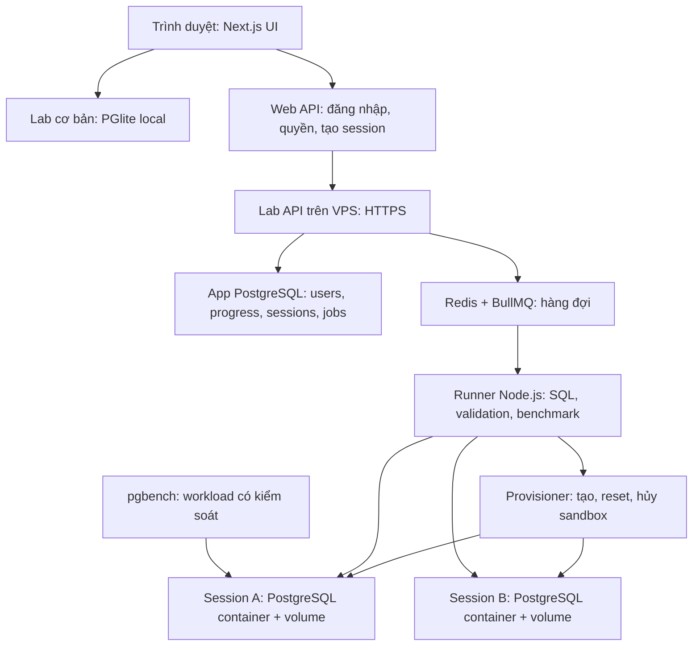

# Thiết kế lab PostgreSQL trên server

**Trạng thái: đề xuất, chưa triển khai.** Tài liệu này mô tả phần cần xây thêm để học performance với database lớn và workload thật. Nó không mô tả chức năng đã có trên web.

**Phạm vi file này là lab do DataLab host:** chủ web thuê compute/storage và cấp session cho learner. Hướng mới cho phép learner cài dataset vào PostgreSQL của họ, rồi dùng web để chạy/phân tích/trực quan hóa qua connector, được mô tả riêng tại [lab trên database của người học](own-database-labs-design.md). PostgreSQL được ưu tiên trước; MySQL là nhánh sau. Hướng database riêng không cần container/session nằm trên VPS DataLab như thiết kế dưới đây.

## Vì sao cần phần này?

Hiện người học đã chạy được SQL/index thật trong browser với tối đa 100K orders. Dataset nằm trong RAM thiết bị; request chạy tuần tự trên một connection. Khi muốn học với hàng triệu dòng, I/O server hoặc nhiều connection tranh tài nguyên, cần bổ sung môi trường thực thi có tài nguyên, workload và cơ chế đo phù hợp.

Thêm người làm các bài browser không tự đòi hỏi một database server cho mỗi người. Thêm người dùng **server labs** lại cần quản lý số database tạm và công việc nặng đang hoạt động. Bởi vậy thiết kế dưới đây vừa bổ sung loại bài học, vừa tạo bài toán quota/queue/cleanup cho người vận hành. Xem [giải thích hoạt động và các nghĩa của scale](how-it-works-and-scales.md) trước nếu các khái niệm này còn khó hình dung.

## Mục tiêu và phạm vi

Giữ các bài SQL cơ bản chạy trong trình duyệt để vào học nhanh và giảm chi phí. Thêm chế độ server cho bài cần hàng triệu dòng, index lớn, disk I/O, nhiều connection, lock, transaction hoặc workload cạnh tranh.

Người học sẽ có **session database riêng trên tài nguyên server do chủ web thuê**. CPU/RAM của máy người học chủ yếu dùng cho UI; query server dùng CPU/RAM/SSD của máy chủ. Không cần người học cài PostgreSQL.

Ưu tiên pilot: một bài index với dataset lớn và một bài tối ưu query dưới tải. Các bài deadlock, transaction ghi dữ liệu hoặc incident nhiều connection mở rộng sau khi cơ chế cô lập/cleanup đã ổn định.

## Kiến trúc đề xuất



Đề xuất đặt web trên Vercel, gateway/runner/queue/database trên VPS Linux. Giai đoạn pilot có thể cùng một VPS; benchmark cần ít nhiễu hơn thì chuyển App DB hoặc runner phụ ra host khác.

API web chỉ xác thực, kiểm tra quyền, submit job và trả `jobId`; browser poll trạng thái/kết quả qua endpoint kiểm tra ownership. Không giữ request Vercel chờ toàn bộ benchmark nhiều phút. SSE có thể bổ sung sau khi polling hoạt động ổn định.

## Hai nhóm database khác nhau

| Nhóm | Dữ liệu | Vòng đời |
| --- | --- | --- |
| App PostgreSQL | Tài khoản, tiến độ, dataset versions, sessions, jobs và kết quả benchmark | Lâu dài, cần backup và migration |
| PostgreSQL của lab | Dataset tổng hợp, index/query do người học thử, transaction/locks của bài | Tạm thời, có TTL, reset/hủy được |

Không chạy SQL của người học trên App DB. Credential App DB không được đưa vào browser hoặc container lab.

Thiết kế pilot ưu tiên **mỗi session một PostgreSQL instance/container**. Chỉ tạo nhiều database trong cùng một PostgreSQL instance có thể tách dữ liệu, nhưng vẫn chia sẻ resource/connection limits và nhiều thống kê; chưa đủ để cô lập benchmark.

Container vẫn chia sẻ kernel/hardware. Nó không tương đương thuê một VPS riêng cho mỗi người học và không tạo ra CPU vật lý độc quyền.

## Dataset lớn và khả năng tái lập

Đề xuất profile khởi đầu: **1 triệu orders + 3 triệu order_items**, khoảng 100.000 customers và 10.000 products. Đây là dataset mới, khác fixture browser. Profile 10 triệu orders chỉ bổ sung sau khi đo storage, bootstrap và thời gian chạy thực tế.

Mỗi dataset cần manifest phiên bản: schema, seed/generator version, số dòng, phân phối dữ liệu, checksum hoặc kiểm tra tính nhất quán, PostgreSQL version, statistics và index ban đầu.

Phân phối cần phục vụ bài: khách hàng mua nhiều, sản phẩm hot, thời điểm cao tải, filter chọn lọc khác nhau, tương quan cột; NULL/duplicates ở các cột được schema cho phép. Dùng dữ liệu tổng hợp, không cần dữ liệu khách hàng thật.

Chuẩn bị template trước, sau đó clone/restore cho session; không sinh hàng triệu dòng đồng bộ trong mỗi request mở bài. Có thể dùng dump/restore, template database hoặc volume snapshot, nhưng phải đo thời gian và dung lượng thật. Clone không mặc nhiên là tức thì hay copy-on-write. Với PostgreSQL template database, có các ràng buộc kết nối khi copy; chọn quy trình provision phù hợp. [PostgreSQL CREATE DATABASE](https://www.postgresql.org/docs/current/sql-createdatabase.html).

Tính storage theo bảng + index + WAL + temp files + số bản clone + headroom. Số dòng không đủ để suy ra cần bao nhiêu GB RAM/SSD. Template phải được giữ ở trạng thái có thể tái lập, không để query người học sửa vào bản gốc.

## Vòng đời session và job

Đề xuất state machine:

```text
queued → provisioning → ready → running → ready
                          ↓       ↓
                       resetting → ready
                          ↓
                        expired → destroyed

Lỗi ở bước bất kỳ → failed → cleanup → destroyed
```

1. Người học bấm Start server lab; backend xác thực user, entitlement, quota và lựa chọn lab/dataset từ catalog tin cậy.
2. Hết slot thì vào hàng đợi, hiển thị đang chờ và cho phép hủy. Không mở thêm container vô hạn.
3. Provisioner tạo container/volume/network/role theo template đã duyệt, gán owner và expiry.
4. Runner kiểm tra health, setup bài, thu baseline rồi chuyển `ready`.
5. Run/Check/Benchmark tạo job, chỉ truy cập session thuộc user đó. SQL và config validation đều được kiểm tra lại ở server.
6. Reset phục hồi template riêng; job đang chạy cần được dừng an toàn trước.
7. End/TTL/idle timeout hủy session, cleanup container/volume và cập nhật trạng thái.

Mức khởi đầu để thử nghiệm: session 20–30 phút, idle 5–10 phút, query timeout khoảng 30 giây, benchmark 2–5 phút. Đây là **budget đề xuất**, phải hiệu chỉnh bằng pilot; không phải timeout đang có trong beta browser.

Job cần ID ổn định, ownership, lease/heartbeat, cancel và giới hạn thời gian. Cleanup phải idempotent và có sweeper thu hồi resource mồ côi sau crash. Không tự retry mọi SQL: query ghi dữ liệu có thể đã commit trước khi connection lỗi.

## Workload và metrics thật

Runner dùng `pg` kết nối PostgreSQL; workload dùng `pgbench` với script phù hợp bài, client count/rate/duration có giới hạn. `pgbench` thực thi transaction/query thật và báo throughput, latency, lỗi; có thể dùng custom script. [PostgreSQL pgbench](https://www.postgresql.org/docs/current/pgbench.html).

Một thí nghiệm gồm: khôi phục dataset → warm-up → đo baseline → người học sửa index/query → warm-up tương đương → đo lại. Lưu config và metadata để so sánh cùng điều kiện. Có thể thử 10/20/50 client, nhưng đó là điểm thử, chưa phải tải được bảo đảm.

| Metrics | Thu ở đâu? | Lưu ý |
| --- | --- | --- |
| Plan, actual rows, execution/planning time, buffers | `EXPLAIN (ANALYZE, BUFFERS, FORMAT JSON)` | ANALYZE chạy query thật; chỉ bật trong phạm vi bài cho phép |
| p50/p95/p99, throughput, timeout/error rate | Samples từ workload/runner | Cần nhiều samples; không suy p95 từ một lần EXPLAIN |
| Connection, lock, wait event | PostgreSQL views do observer có quyền phù hợp đọc | Observer và learner là role khác nhau |
| CPU, RAM, I/O container/host | Runtime/host monitoring | Phân biệt cgroup usage, host load và query-specific cost |
| Browser/API round trip | UI và gateway | Tách khỏi thời gian xử lý SQL trong PostgreSQL |

Buffer hit/read không tự đồng nghĩa disk read vật lý vì còn cache của hệ điều hành. Cần thống nhất chế độ warm-cache và ghi rõ môi trường; tránh xóa cache của host đang phục vụ session khác. Plan và threshold phải kiểm chứng lại trên PostgreSQL server/dataset mới, không sao chép nguyên kỳ vọng từ WASM.

Load generator cũng tiêu thụ CPU/network. Khi chạy cùng host, phải đưa nó vào resource budget; khi cần đo chính xác hơn thì dùng host tạo tải riêng. Giai đoạn đầu chỉ cho **một benchmark nặng hoạt động tại một thời điểm trên host**, dù có nhiều user đang xem web.

## Cô lập và bảo vệ resource

- HTTPS gateway; các port PostgreSQL/Redis chỉ trong mạng private. Browser không nhận password database hoặc host tùy ý.
- Role learner không superuser, không cài extension, đọc file server hoặc truy cập App DB; DDL/DML cho phép theo từng loại lab.
- Server phân tích/chặn SQL theo policy và parser thích hợp; client guard hiện tại chỉ là lớp UX bổ sung, không phải biên an toàn duy nhất.
- Đặt CPU/RAM/PID/disk/connection quota, statement/lock timeout và giới hạn result. Mặc định container Docker không có resource limit phù hợp nếu chưa cấu hình. [Docker resource constraints](https://docs.docker.com/engine/containers/resource_constraints/).
- Hạn chế egress, không privileged container, không mount secret hoặc filesystem của host vào lab. Filesystem chỉ writable tại vùng cần cho database.
- Provisioner có quyền Docker nên phải tách khỏi public API, dùng lệnh/template allowlist. Không expose Docker TCP API hoặc đưa quyền Docker socket trực tiếp cho handler nhận SQL.
- Giới hạn số session/user, rate limit job và benchmark. Khóa sở hữu session phải kiểm tra ở mỗi operation, kể cả lấy kết quả/hủy/reset.
- Không mặc định lưu toàn bộ SQL lâu dài; xác định retention, quyền đọc log và thông báo người học trước khi lưu lịch sử server.

## Thay đổi cần làm trong code

1. Thêm account/auth và App DB migrations: `users`, `learning_progress`, `dataset_versions`, `lab_sessions`, `query_runs`, `benchmark_runs`; subscription chỉ khi triển khai thanh toán.
2. Bổ sung metadata execution mode/dataset version cho bài; chưa có field này trong `Lab` hiện tại.
3. Xây `ServerPostgresAdapter` tương thích mục tiêu của [DatabaseAdapter hiện tại](../lib/engine/types.ts), với session/job lifecycle riêng. Không thay đổi adapter browser đang dùng cho bài cơ bản.
4. Thêm gateway, queue, runner, provisioner và config deploy/Compose. Hiện repo chưa có các service này.
5. Chấm bài tại server từ cấu hình do server quản lý; browser không được gửi reference SQL hoặc validation rules tùy ý để quyết định pass.
6. UI có hàng đợi, provisioning, thời gian còn lại, load config được phép, cancel/reset và thông báo lỗi có thể khôi phục.
7. Đồng bộ tiến độ có account; quyền Pro được kiểm tra ở server nếu mở lab trả phí. `lib/billing.ts` hiện chỉ là contract, chưa đáp ứng bước này.

## Điều kiện nghiệm thu pilot

- Session A sửa index không làm thay đổi dữ liệu/plan của session B; user B không đọc/hủy session A được.
- Dataset mới đạt đúng manifest; baseline và đáp án qua validator trên toàn bộ kết quả.
- Benchmark thật tạo nhiều connection, có samples latency và lỗi; UI phân biệt số đo với simulation.
- Query quá hạn có thể hủy; vượt quota không làm App DB hoặc host mất ổn định.
- Reset/end/expiry/crash đều thu hồi container/volume, không để session mồ côi tăng dần.
- Đo bootstrap, RAM peak, disk peak, I/O và thời gian benchmark trước khi công bố capacity hoặc mua thêm máy.

## Ranh giới pilot và mở rộng nhiều host

Thiết kế này tập trung pilot một VPS. Chưa có số đo để cam kết một máy phục vụ bao nhiêu session, và queue chỉ điều tiết công việc theo capacity hiện có. Nếu nhu cầu đến nhanh hơn khả năng xử lý trong thời gian dài, thời gian chờ sẽ tăng.

Khi thêm host, cần scheduler theo tài nguyên, đặt chỗ slot có kiểm soát, lưu `sessionId → hostId`, điều phối job về đúng host, lease/heartbeat và dọn resource sau lỗi. Template và phiên bản PostgreSQL/dataset phải nhất quán; baseline/after cần đo trong điều kiện tương đương. Tăng số runner đơn thuần chưa cấp thêm tài nguyên cho PostgreSQL.

Những phần nhiều host/autoscale này chưa có implementation và chưa được đặc tả đầy đủ trong pilot. Ví dụ capacity, throughput và hướng mở rộng được giải thích tại [hoạt động và scale](how-it-works-and-scales.md). Hạ tầng và cách tính chi phí được mô tả trong [Deploy và chi phí](deployment-and-costs.md).
